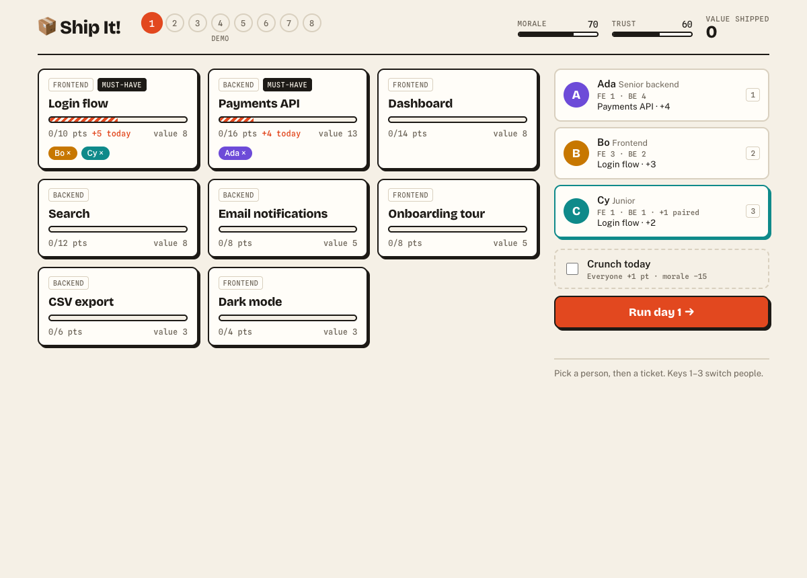
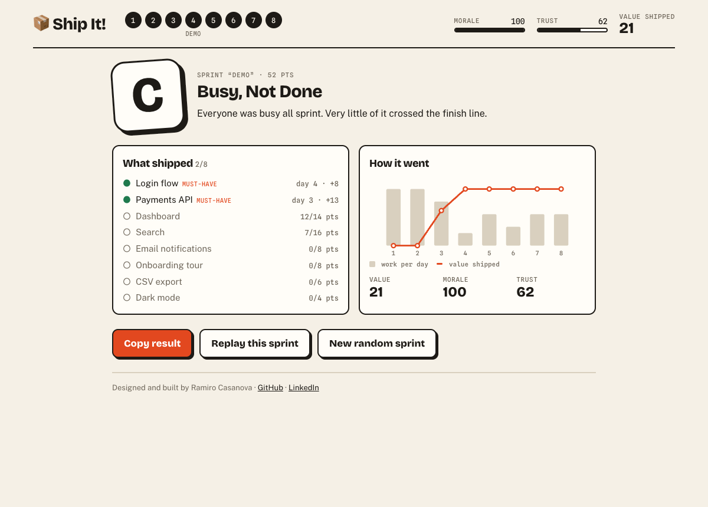

# 📦 Ship It!

A three-minute browser game about running a sprint. Eight days, three developers, and more work than will fit. Each morning you decide who works on what; each evening something goes wrong and you decide what to do about it.

**[Play it →](https://casanovaramiro.github.io/ship-it/)**



## How it plays

- **Only shipped tickets count.** Half-built work scores nothing.
- **People have strengths.** Ada is fast on backend, Bo on frontend, and Cy, the junior, doubles their pace when pairing.
- **Events force trade-offs.** Scope creep, a production incident, a sick day, a bad estimate. Every choice shows its cost before you make it.
- **Three things are scored:** value shipped, team morale and stakeholder trust. Miss a must-have and the rest hardly matters.

Every sprint comes from a seed in the URL. The default seed is today's date, so everyone gets the same daily sprint, and a copied result links back to the exact sprint that produced it.



## How it's built

React 19, TypeScript and Vite. No other runtime dependencies.

**The game is a pure function.** Everything in `src/engine` is `(state, input) => state`, with no React, no clock and no `Math.random`. Randomness comes from a seeded generator whose state lives inside the game state. That one decision is what makes the rest cheap: the same seed always replays the same sprint, tests need no mocks, and the UI is a thin layer that renders state and holds no rules of its own.

**The difficulty is tested, not guessed.** `src/engine/bot.ts` has two automated players, one that plans sensibly and one that plays at random. `balance.test.ts` runs each through 500 sprints and asserts the design holds:

| | Careful bot | Random bot |
| --- | --- | --- |
| Average score | 79 | 11 |
| Tickets shipped (of 8) | 5.3 | 2.4 |
| Missed a must-have | 0% | 99% |
| Grades | 2 S · 414 A · 84 B | 1 B · 4 C · 495 D |

The first version failed these tests: the careful bot earned the top grade in 85% of sprints, so the backlog was made heavier and the grade thresholds raised. Now planning is clearly rewarded, the backlog can't be finished, and an S takes better judgement than the bot has.

```
src/
  engine/       rules, events, scoring, seeded RNG, bots, tests
  components/   board, team, event dialog, scorecard
  App.tsx       wires engine state to the UI
```

## Run it

```sh
pnpm install
pnpm dev        # play locally
pnpm test       # 26 tests: rules, events, determinism, balance
pnpm balance    # print the bot score distributions
pnpm build      # static site in dist/, deployable anywhere
```

---

Designed and built by [Ramiro Casanova](https://github.com/CasanovaRamiro) · [LinkedIn](https://www.linkedin.com/in/ramiro-casanova)
